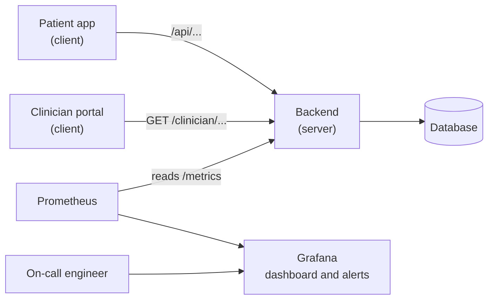
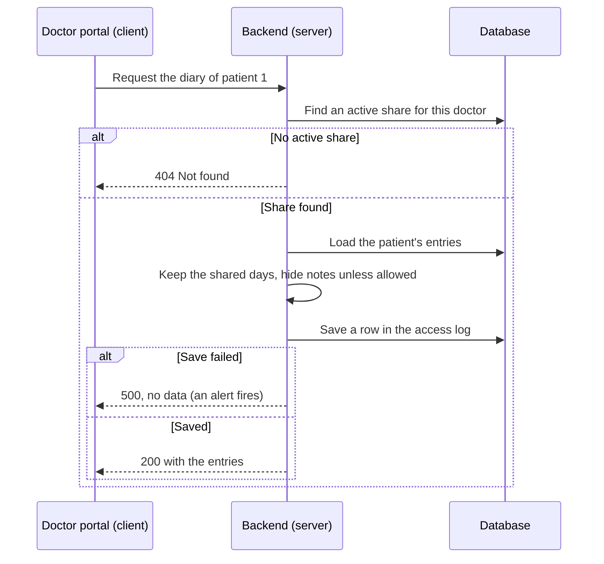
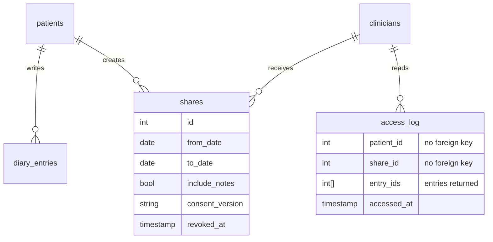
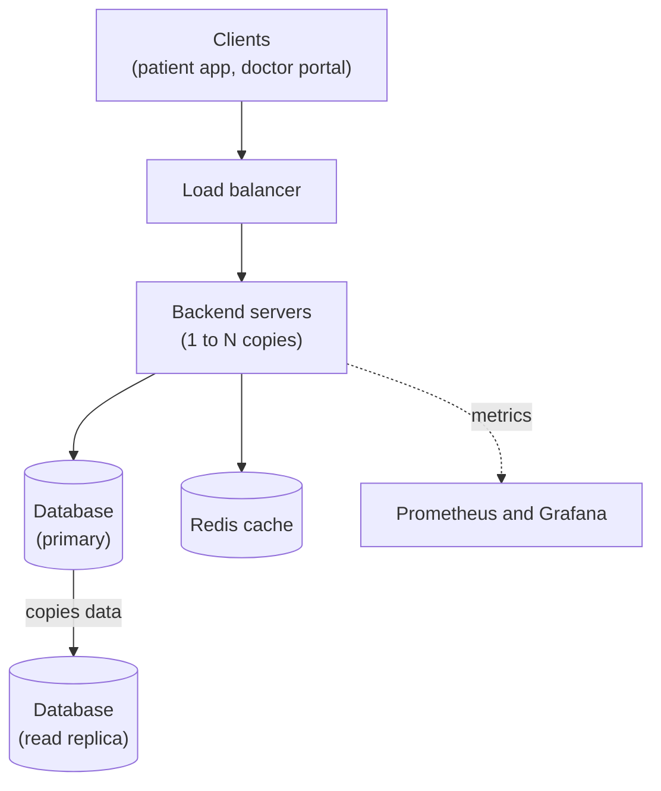
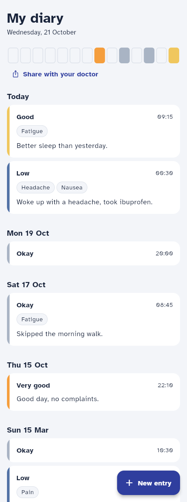
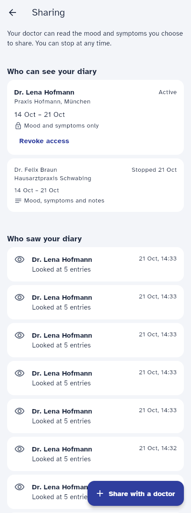
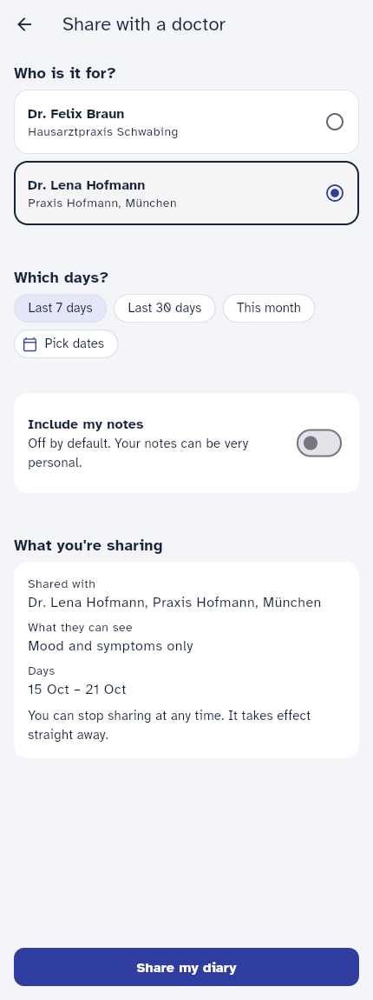
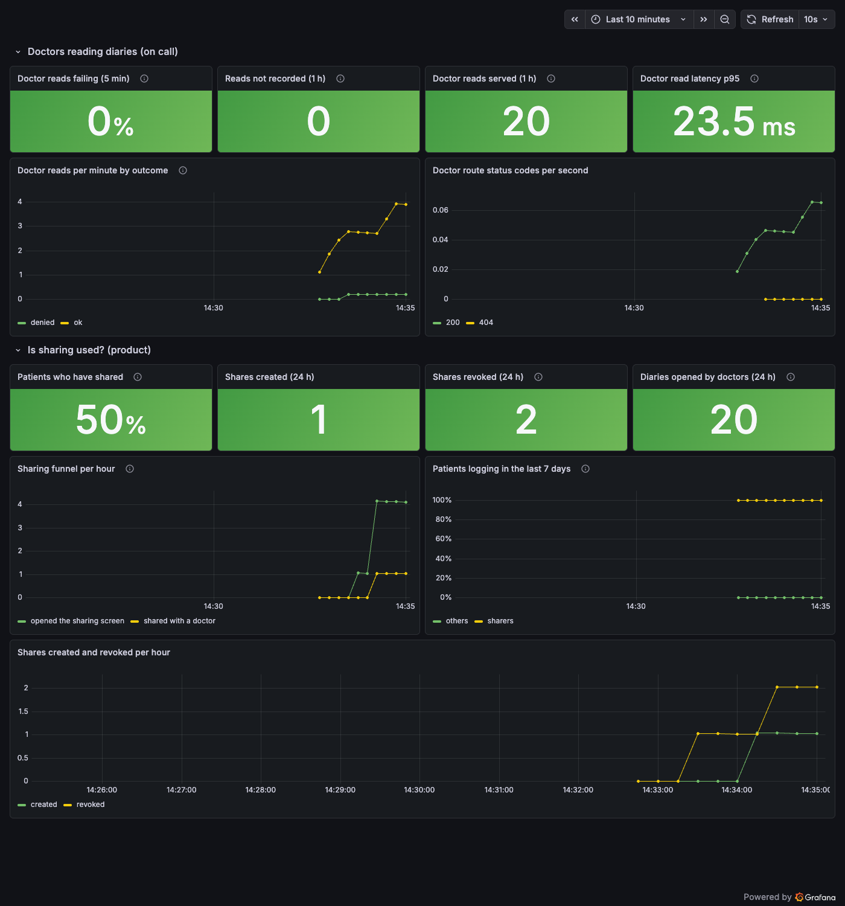

# Share My Diary With My Doctor: Notes

Time spent: about 2 hours.

## Summary

This feature lets a patient share their diary with a doctor, stop sharing at any time, and see who looked at it.

- **Patient (app):** chooses a doctor, a period and whether notes are included (off by default), and reviews a summary before confirming. The patient can later see who has access, revoke it, and see who read the diary.
- **Doctor (API only):** can view the diary for the shared period. Every access is recorded in an access log.
- **Privacy:** notes stay hidden unless the patient includes them. A doctor cannot find out whether a person is a patient. No health data appears in logs or metrics.
- **Monitoring:** a Grafana dashboard and three alerts. One alert pages the on-call engineer when a doctor's access to a diary could not be recorded.

## Architecture

### System overview

The patient app and the clinician portal are clients. The backend is the server. It stores data in PostgreSQL and exposes metrics that Prometheus reads and Grafana displays.

### Doctor access flow

**Note:** the access is recorded before any data is returned. If the record cannot be saved, the doctor receives nothing. Requirement O.Log_1 says every access must be recorded, so the system chooses "no data" over "data without a record".

## Data model decisions

### Tables

- **`shares`** has one row per share: a patient, a doctor and a period. It stores `consent_version` (the wording the patient agreed to) and `revoked_at`.
- **`access_log`** has one row per doctor access, with the ids of the entries that were returned. This matches the shape of `GET /access-log`.
- The migration is `backend/alembic/versions/0002_sharing.py`.

### Design decisions

1. **Check the share on every read.** A patient who stops sharing is protected immediately (O.Cons_2). Share status is never cached.
2. **Keep the access log in its own table that cannot be changed.** Auditors must be able to trust it for 10 years, so a database trigger rejects every UPDATE and DELETE.
3. **Store `patient_id` and `share_id` in the access log as plain numbers, not foreign keys.** If a patient asks for erasure, their rows can be deleted without the log getting in the way (see the Erasure section).
4. **Return the same 404 for "no such patient" and "not shared with you".** Otherwise a doctor could try ids and learn who is a patient.
5. **Keep notes off by default and decide per share.** The medical lead does not need notes, and data protection requires them to stay private unless the patient agrees.
6. **Use the patient's time zone for days.** An entry logged at 00:30 belongs to that day, not the day before.
7. **Read old `app-v1` entries as local time.** App v1 stored local time as if it were UTC, so the backend corrects this when reading (explained below).
8. **Leave `/entries` and `/me` unchanged.** App 2.3 fails if those responses change.
9. **Revoke with a timestamp (`revoked_at`) instead of deleting.** The history of what was shared is kept.
10. **Show a summary before sharing.** The patient sees the doctor, the data and the days (O.Purp_1).

### Handling `app-v1` entries

A patient in Berlin writes an entry at 23:50 on 14 March. App v1 stored `23:50` as if it were UTC, although the real time was 22:50 UTC. If the backend treated it as UTC and converted it to Berlin time, the entry would fall at 00:50 on 15 March, which is the wrong day.

For `app-v1` entries the backend does not convert. It treats the stored clock time as already being in the patient's time zone (function `patient_day` in `backend/app/api.py`). Test: `test_app_v1_entries_are_read_as_local_time`.

**Limit:** during the one hour a year when clocks change, the exact hour can be off. This was accepted for old data.

## Assumptions and open questions

- **How does a doctor learn a patient's id?** `API.md` has no "my patients" endpoint. The assumption is that the portal obtains the id elsewhere.
- **Consent text:** a version label (`2026-10-v1`, constant `CONSENT_VERSION`) is stored. There is no screen with the full legal text and no API to manage versions. The app shows a summary instead.
- **Days:** the app picks days on the phone's local calendar, and the backend uses `patients.timezone`. These are assumed to be the same.
- **Unknown doctor:** `POST /shares` returns 422, as the brief says invalid input returns 422.
- **Overlapping shares** are allowed. A note is visible for an entry if any share covering that entry's day includes notes.
- **An access that returns no entries** is still logged, because the doctor opened the diary.
- **A denied request** (no active share) is not written to `access_log`, because no data was accessed. It is only counted in a metric.
- **Revoke** can be repeated safely and keeps the first `revoked_at`. Revoking another patient's share returns 404.
- **Period length:** there is no maximum.
- **Login:** authentication is a stub, so no login was built.

## Requirements

| ID | Applies? | Where it is met (code, test), or why not |
| --- | --- | --- |
| O.Purp_1 | Yes | The "What you're sharing" summary (doctor, data, days) in `app/lib/new_share_screen.dart` (`_Summary`). Test: `app/test/sharing_test.dart`, "shares the last 7 days with a doctor". |
| O.Cons_1 | Yes | Doctors read only through an active share, only for its days, and notes only if `include_notes` is set. `clinician_entries` in `backend/app/api.py`. Tests: `backend/tests/test_clinician_entries.py` (shared period, notes, other doctor, no share). |
| O.Cons_2 | Yes | `POST /shares/{id}/revoke`. The share is checked on every read, so a revoke applies to the next access. Tests: `test_other_doctors_and_revoked_shares_get_nothing`, `test_revoke_sets_revoked_at_and_is_idempotent`. |
| O.Cons_3 | Yes | `shares.consent_version` stores the wording version (`CONSENT_VERSION`). Test: `test_share_stores_the_version_of_the_consent_text`. Limit: only a version label is stored, not the wording itself. |
| O.Auth_1 | No (not built) | Authentication is a stub: the token has no login time and the app has no login screen. A simulated check would look compliant without protecting anything. Intended design: real tokens with an `auth_time`. `POST /shares` (the consent step) returns 401 "log in again" when `auth_time` is older than 15 minutes, and the app sends the patient to log in and then retries. |
| O.Pass_1 | No | The system has no passwords. |
| O.Log_1 | Yes | Each successful doctor access saves an `access_log` row (doctor, patient, entry ids, time) before data is returned. Tests: `test_reads_are_recorded_and_shown_to_the_patient`, `test_a_read_with_no_entries_is_still_recorded`. |
| O.Log_2 | Yes | `GET /access-log` and the "Who saw your diary" list in the app. Tests: the same test as above, and "shows who can see the diary and who looked" in `sharing_test.dart`. |
| O.Log_3 | Partly | A trigger blocks UPDATE and DELETE on `access_log`. Test: `test_access_log_cannot_be_changed`. Not done: nothing deletes old rows, but the table owner could still drop the trigger, and TRUNCATE is not blocked (the tests use it to reset the database). In production the application's database user should only have INSERT and SELECT, without the TRUNCATE privilege, and backups need the same retention. |
| O.Log_4 | Yes | The request log writes only the method, route template, status and duration. It no longer writes the body or the real path. The Uvicorn access log is off (`--no-access-log` in `backend/Dockerfile`). Errors log only the error type, because messages can contain query values. Tests: `backend/tests/test_hardening.py`. |
| O.Mon_1 | Yes | Counter `access_log_write_failures_total` and the Grafana alert "A doctor read was not recorded in the access log" (`observability/grafana/alerting/rules.yml`). Test of the counter: `test_no_data_is_returned_when_the_access_cannot_be_recorded`. The alert rule loads and runs without errors, but this exact alert was never triggered. The similar "Doctors cannot open diaries" alert was triggered by stopping the database, and it reached the pending state. |
| O.Err_1 | Yes | Unexpected errors return `{"detail": "Internal server error"}` with no details (`backend/app/main.py`). Test: `test_unexpected_errors_reveal_nothing_and_are_still_counted`. Notes: a 422 repeats the input the caller sent, and `/docs` is public in this local setup and should be disabled in production. |
| O.Cryp_1 | Yes, outside the code | Encryption at rest belongs to the infrastructure: an encrypted database disk, or a managed PostgreSQL with encryption enabled, using a method the security officer approves. The local Docker database is **not** encrypted. Field-level encryption was not added. |
| O.Del_1 | Stretch (not built) | See the next section. The design does not block it. |
| O.Doc_1 | Yes | This table. |

## Erasure (O.Del_1): how I would do it

**Definition:** erasure means that when a patient asks, their data is deleted. It was not built, but nothing in the design blocks it.

**Steps for one patient, in one database transaction:**
1. Delete their `diary_entries`.
2. Delete their `shares`.
3. Delete or anonymize their `access_log` rows (see the options below).
4. Delete the `patients` row.
5. Write an `erasure_log` row ("patient erased on this date"). It contains no health data and serves as proof that the erasure happened.

**The conflict in the brief:** data protection requires erasing all data. The medical lead wants to keep the record of which doctor saw what, as clinical evidence. O.Log_3 also requires access records to be kept for ten years. This is a legal decision, so the right step is to request a decision and then implement one of two options:
- **Option A, full erasure:** delete the access log rows as well.
- **Option B, keep the evidence:** keep the rows but remove the link to the patient. What remains is the doctor, the time and the number of entries. The log holds no health data, only ids and times.

**Why this is possible today:**
- `access_log` has no foreign key to patients, so deleting a patient is never blocked by the log.
- The log contains no names or notes.
- Logs and metrics contain no health data, so there is nothing to clean there.

**Points to handle when building it:**
- The trigger blocks UPDATE and DELETE, so the erasure job needs a controlled exception, for example a separate database role, or a trigger that allows changes only when a setting is enabled by that role. Every use must be logged.
- Backups hold the data until they expire. The privacy policy should say so, or the backup process must be able to remove a patient.
- A test should confirm that after erasure no row anywhere refers to the patient id.

## Monitoring

Two groups need different answers: product and on-call.

### Product: do patients use sharing, and do the ones who share keep logging?

| Question | Measure | Where |
| --- | --- | --- |
| How many patients shared? | `diary_patients{cohort="sharers"}` divided by all patients | Dashboard, "Patients who have shared" |
| Do people finish the flow? | App events `sharing_opened` and `share_created` | Dashboard, "Sharing funnel per hour" |
| Do sharers keep logging? | `diary_patients_logging_7d` divided by `diary_patients`, for sharers and others | Dashboard, "Patients logging in the last 7 days" |
| Do people stop sharing? | `shares_revoked_total` next to `shares_created_total` | Dashboard |
| Do doctors actually open shared diaries? | `clinician_reads_total{outcome="ok"}` | Dashboard |

A *cohort* is a group of patients. Here the groups are "sharers" (shared at least once) and "others". The backend counts them when Prometheus asks and exposes totals only, with no ids or names, as required by data protection.

These metrics do not raise alerts. They are meant for the three-month review, where sharers are compared with others and the funnel is checked.

### On-call: can doctors access patient diaries?

The failure to detect is a doctor with a valid share who cannot view the diary. Either the backend returns a server error (5xx), or the access cannot be recorded, so no data is returned.

| Signal | Alert | Action |
| --- | --- | --- |
| An access could not be recorded (`access_log_write_failures_total` increases) | **Page, immediately** | Doctors receive nothing and requirement O.Log_1 is at risk. Check the database and the API logs. |
| More than 10% of doctor requests fail with a server error (5xx) for 5 minutes | **Page** | Clinics will call support. Check the dashboard, then the API logs. |
| The 95th percentile of response time for doctor requests is above 2 seconds for 15 minutes | **Next morning** | The feature works, only slowly. |

Denied requests (404) do not alert. They are normal, for example right after a patient revokes access, and they appear on the dashboard only.

### Incident response

1. Open the "Diary sharing" dashboard in Grafana (`make observe`). The top row is for on-call.
2. Run `make logs`. Each line has the form `METHOD /route -> status in N ms` and never contains a body. A line `Access log write failed: <ErrorType>` or `Unhandled <ErrorType>` shows what failed.
3. Check that the database is running.

### Limitations

- A bug that returns **200 with a wrong or empty list**, for example a day-filter mistake, raises no error and no alert. Tests are the protection for this case.
- Only requests that reach the backend are measured. If the clinician portal or the network is down, there are no failures to see. A synthetic check (a job that opens a test diary every minute) would cover this.
- With very few patients, the counts for "sharers" and "others" could identify one person. In production, a group's numbers should be hidden when it has fewer than N patients (for example N = 10).
- The cohort counts run a small database query at every scrape.
- `/telemetry` accepts any event name that matches the allowed pattern, and every new name becomes a new metric series. This comes from the starter code, and `API.md` allows it. Counting only a limited number of distinct names (the rest as `other`) would bound it.
- Prometheus ignores the first value of a counter that appears already above zero. The known counters start at 0 to avoid this.
- The alert thresholds (10%, 2 s) are first estimates and should be tuned with real traffic.

## Scaling considerations

This section describes ideas only. None of it is built. Today there is one backend and one database, which is enough for a small clinic network. As usage grows, the system should grow in small steps, each one justified by a measurement.

1. **More backend servers behind a load balancer.** The backend keeps no state between requests, so copies can be added easily. Add health checks and autoscaling.
2. **A connection pooler (PgBouncer).** Many servers would otherwise open too many database connections.
3. **Redis for safe data only:** the list of doctors and rate-limit counters (to stop abuse of the doctor endpoint). Diary entries are **not** cached, and the check "is this share active?" is **never** cached.
4. **A read replica** for data that may be a few seconds old: the patient's own history, reports and dashboards. A replica can lag, so a doctor could still open the diary after a patient revoked, which would break O.Cons_2. Therefore **the share check and the access log write always use the primary.**
5. **The access log is never queued or cached.** A queue could lose a record, which breaks O.Log_1. Queues are suitable for harmless work such as product events.
6. **Partition `access_log` by month.** It must be kept for 10 years. Monthly partitions keep queries fast, and old months can move to cheap, locked storage.
7. **Shard by `patient_id` only if one primary is not enough.** This fits because almost every query concerns one patient. It is a large change, so it comes last.
8. **Basics:** encrypted disks and backups with point-in-time recovery, TLS everywhere, secrets in a secret store, `/docs` disabled in production, and the same alerts for every server.

## Screenshots

A demo video of the patient flow (about 1 minute):

<video src="https://github.com/user-attachments/assets/0ee1666f-b838-48f3-9b7c-827b0b4d099f" controls width="720"></video>

If the player does not load, [watch it on Google Drive](https://drive.google.com/file/d/1rYEoxd4FTtgjIjTbHZtCM2Xi_ckTJfAq/view?usp=sharing).

The diary, with the new "Share with your doctor" button:

Who can see the diary and who looked:

Sharing with a doctor, with the summary shown before confirming:

The Grafana dashboard (`make observe`, then http://localhost:28003):

## How I used AI

I used Claude Code (the command-line tool) for the whole task.

**Workflow**
1. I had it read the task documents and the code first, and list the pitfalls before writing any code.
2. We agreed on a plan and built it one commit at a time. I reviewed the files before each commit.
3. For each piece, I set the requirements and the approach, and the agent drafted the code and tests. I reviewed every file and decided whether it was ready before it was committed. The agent's checks (`make test`, `make lint`, `curl`, the browser and Grafana) supported my review but did not replace it.

**Where the agent was wrong and was corrected**
- It first described the monitoring blind spot as "a doctor with a valid share gets a wrong 404 because of a filtering bug". That was wrong: a filtering bug returns a 200 with a wrong list, because a 404 only means "no active share". I questioned it and the notes were fixed.
- The new cohort metric made `/metrics` return a 500 (labels passed in the wrong position). The existing tests caught it before it was committed.
- The first version of the error handling skipped the metrics for crashed requests, so 5xx errors would have been invisible to the on-call alert. It was moved into the middleware.
- On the dashboard, "Patients who have shared" showed "No patients" (the query did not match the labels) and the funnel missed the first event of each counter. Both were found by looking at the real dashboard, not by tests.
- A test fake sent text in the wrong encoding, and one check picked the wrong request.

**Decisions I made:** the scope (no doctor screen, because the README says it is not needed, and no login, because authentication is a stub in this project), approving every commit myself, which monitoring signals and alerts to build, adding the scaling section, commit messages without a co-author line, and the simple wording of this file.

## Next steps

- Build erasure (see above) after legal decides between option A and B.
- Add real login with re-authentication before sharing (O.Auth_1).
- Store the full consent wording and show it in the app, not only a version label.
- Group repeated doctor accesses in "Who saw your diary" (for example "Dr. Hofmann, 12 times today"). Today every access is its own row.
- Hide a group's numbers when fewer than N patients are in it (for example N = 10), so that no single patient can be identified from the product metrics.
- Add a synthetic check that opens a test diary every minute, to detect an unreachable portal or network.
- Prove the access-log alert end to end in a test environment (make a write fail on purpose and watch the alert fire).
- Filter by day in SQL instead of Python once diaries grow large, so that the database returns only the shared entries. Add the scaling steps above only when measurements show they are needed.
- Disable `/docs` in production and use a database user that can only INSERT and SELECT on `access_log`.
